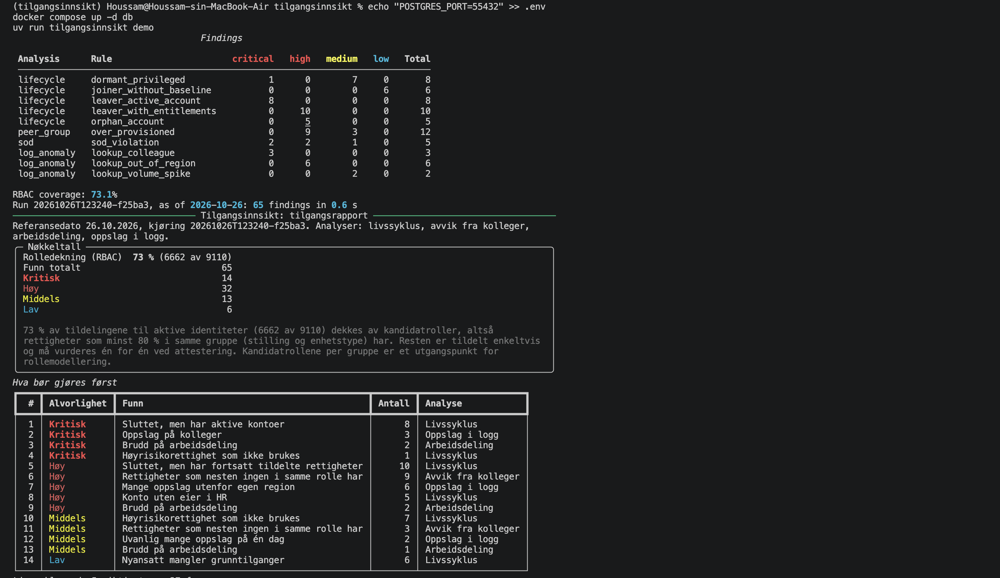
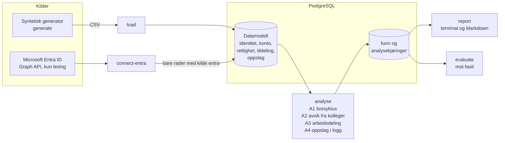
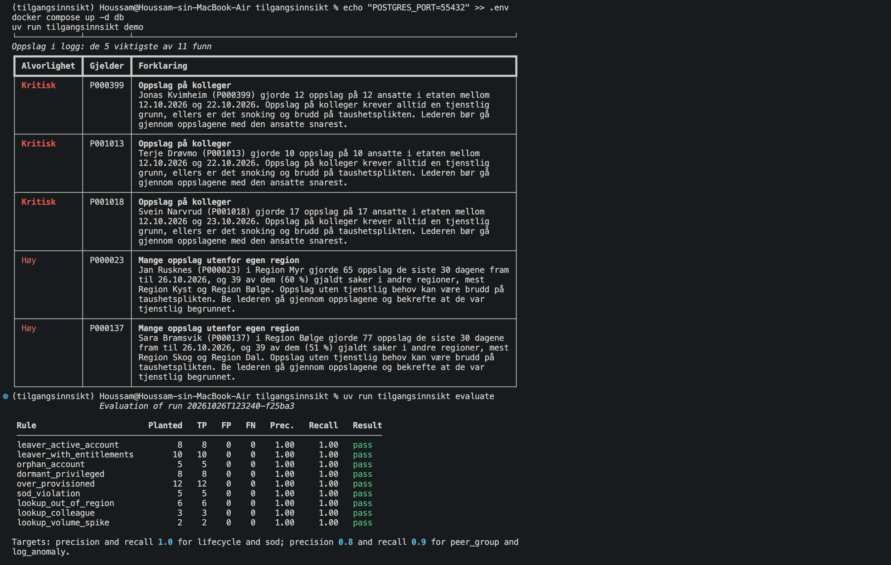

# Tilgangsinnsikt

**English summary.** Tilgangsinnsikt is an access governance analytics tool. It loads
identities, accounts, entitlements and access logs from HR data, Microsoft Entra ID (read-only
Graph API) and line-of-business applications into one IGA-style model in PostgreSQL. Four
analyses then find leavers with active access, orphan accounts, dormant privileges,
entitlements that are rare among peers, segregation-of-duties conflicts and suspicious
lookups in the access log. Every finding comes with a Norwegian explanation a manager can act
on. The repository ships a synthetic organisation with planted weaknesses and a ground truth,
so the precision and recall of every rule are measured, not claimed. Run it with
`docker compose up -d db && uv run tilgangsinnsikt demo`.

---

Tilgangsinnsikt samler identiteter, kontoer, rettigheter og oppslagslogger fra flere kilder i
én datamodell og finner svakheter i tilgangsstyringen. Hvert funn forklares på norsk, slik at
en leder eller identitetsforvalter kan se hvem det gjelder, hva som er galt og hva som bør
gjøres.



## Innhold

- [Hvorfor](#hvorfor)
- [Arkitektur](#arkitektur)
- [Analysene](#analysene)
- [Kom i gang](#kom-i-gang)
- [Koble til Entra ID](#koble-til-entra-id)
- [Sikkerhet og personvern](#sikkerhet-og-personvern)
- [Veikart](#veikart)
- [Lisens](#lisens)

## Hvorfor

Tilganger vokser over tid. Folk bytter stilling og beholder det gamle, kontoer blir stående
etter at noen har sluttet, og privilegier som ble gitt for et prosjekt, blir aldri tatt bort.
Samtidig ligger informasjonen spredt: HR-systemet vet hvem som er ansatt, Entra ID vet hvem
som er i hvilke grupper, og fagsystemene vet hvem som har slått opp hva. Norske offentlige
virksomheter har de siste årene fått tydelige krav til både tilgangskontroll og
loggkontroll. Tilgangsinnsikt kobler kildene sammen og gjør kontrollen til en kommando som kan
kjøres jevnlig, i stedet for et regneark som lages én gang i året.

## Arkitektur



Alle analyser leser bare fra datamodellen, og alle koblinger skriver bare til den. En ny kilde
trenger derfor bare en kobling, ikke endringer i analysene. Tunge aggregeringer gjøres i SQL,
og pandas brukes bare til den siste formingen. Mer om oppbyggingen står i
[docs/architecture.md](docs/architecture.md).

### Datamodellen

| Tabell | Innhold |
|---|---|
| `org_unit` | Enheter med region, enhetstype (lokalkontor, regionkontor, direktorat, kontaktsenter) og overordnet enhet |
| `identity` | Personer fra HR: enhet, stilling, leder, ansettelsesperiode og status |
| `application` | Fagsystemer og fagområdet de tilhører |
| `account` | Kontoer i hvert system, med eier (eller ingen eier), status, siste pålogging og kilde |
| `entitlement` | Rettigheter med risikonivå (lav, middels, høy) og kilde |
| `assignment` | Tildelinger av rettigheter til kontoer, med dato, godkjenner og kilde |
| `access_event` | Oppslag i fagsystemene: hvem, når, hvilken region og hvilket fagområde saken gjaldt |
| `finding` | Funn fra analysene, med norsk tittel og forklaring og maskinlesbare detaljer |
| `analysis_run` | Hver analysekjøring med referansedato og hvilke analyser som ble kjørt |

## Analysene

Alle analyser regner fra en referansedato (`--as-of`, standard i dag), ikke fra klokka i
databasen. Samme data og samme dato gir derfor alltid samme funn. Alvorlighetsgradene er
kritisk, høy, middels og lav.

### A1 Livssyklus

**Hva den finner.**

| Regel | Alvorlighet | Funn |
|---|---|---|
| `leaver_active_account` | Kritisk | Person som har sluttet, men har minst én aktiv konto |
| `leaver_with_entitlements` | Høy | Person som har sluttet, men fortsatt har tildelte rettigheter |
| `orphan_account` | Høy | Aktiv konto uten eier i HR |
| `dormant_privileged` | Middels, kritisk hvis aldri brukt | Aktiv person med høyrisikorettighet på en konto som ikke er brukt på 90 dager |
| `joiner_without_baseline` | Lav | Nyansatt som etter 14 dager mangler rettigheter de fleste i samme rolle har |

**Hvorfor det betyr noe.** Avslutning og endring av tilganger er der tilgangsstyring oftest
svikter. En aktiv konto etter sluttdato kan brukes av den som har sluttet, og en ubrukt
privilegert tilgang gir risiko uten nytte.

**Hvordan det beregnes.** En person regnes som sluttet når HR-status er sluttet eller
sluttdatoen er passert. Høyrisikorettigheter er rettigheter med risikonivå høy. Grunntilgangen
for en rolle er rettighetene minst 90 % av personene med samme stilling og enhetstype har, i
grupper med minst 20 personer.

**Unntak.** Deaktiverte kontoer teller ikke som ubrukte privilegier, fordi de ikke kan brukes.
Tildelinger på deaktiverte kontoer teller likevel for personer som har sluttet, fordi de kommer
tilbake hvis kontoen aktiveres igjen. Dynamiske grupper som følger enheten i HR, inngår ikke i
grunntilgangen.

**Målt på syntetiske data.** Presisjon og treffrate 1,00 for de fire reglene med fasit, se
[tabellen under](#målt-presisjon-og-treffrate). `joiner_without_baseline` er informasjon og har
ingen fasit.

### A2 Avvik fra kolleger

**Hva den finner.** Personer med rettigheter som færre enn 10 % av kollegene i samme gruppe
har (`over_provisioned`). Alvorlighet høy hvis minst én av rettighetene har høy risiko, ellers
middels.

**Hvorfor det betyr noe.** En rettighet nesten ingen i samme rolle har, er ofte en rest etter
en tidligere jobb eller tildelt ved en feil. Slike tildelinger er vanskelige å se én og én,
men tydelige når hele gruppen sammenlignes.

**Hvordan det beregnes.** En gruppe er personer med samme stilling og enhetstype (kan endres
til også enhet eller region). For hver rettighet beregnes andelen i gruppen som har den. Bare
grupper med minst 20 personer vurderes. Analysen gir også en **kandidatrolle** per gruppe, det
vil si rettighetene minst 80 % av gruppen har, og nøkkeltallet **rolledekning**: andelen av
alle tildelinger som dekkes av kandidatrollene. Rolledekningen er 73 % i det lille og 75 % i
det store syntetiske datasettet, og den vises øverst i rapporten. Kandidatrollene er
utgangspunktet for rollemodellering.

**Unntak.** Dynamiske enhetsgrupper (`entra:enhet-*`) holdes utenfor, fordi medlemskapet
styres automatisk av enheten i HR og ikke er en tilgangsbeslutning.

**Målt på syntetiske data.** Presisjon og treffrate 1,00.

### A3 Arbeidsdeling

**Hva den finner.** Personer som har rettigheter fra begge sider av en regel om arbeidsdeling
(`sod_violation`). Alvorligheten settes per regel.

**Hvorfor det betyr noe.** Når samme person kan både registrere og godkjenne en utbetaling,
finnes det ingen kontroll mellom dem. Arbeidsdeling er en av de eldste internkontrollene, og
brudd er vanskelige å oppdage uten å se på tvers av systemer.

**Hvordan det beregnes.** Reglene står i [rules/sod_rules.yaml](rules/sod_rules.yaml). En regel
er brutt når én person, på tvers av alle sine aktive kontoer, har minst én rettighet fra
venstre side og minst én fra høyre side.

| Regel | Alvorlighet | Beskrivelse |
|---|---|---|
| `utbetaling-registrere-og-godkjenne` | Kritisk | Samme person kan både registrere og godkjenne en utbetaling. |
| `bilag-registrere-og-attestere` | Kritisk | Samme person kan både registrere og attestere et bilag. |
| `leverandor-og-attestere` | Høy | Samme person kan endre leverandøropplysninger og attestere bilag til utbetaling. |
| `identadmin-og-hr-admin` | Høy | Samme person kan både opprette identiteter sentralt og endre ansettelsesforhold i HR-portalen. |
| `utvikler-og-produksjonsdata` | Middels | En utvikler har lesetilgang til skjermede personopplysninger eller hele arkivet i produksjon. |

**Unntak.** Bare aktive personer og aktive kontoer vurderes. Personer som har sluttet, fanges
av livssyklusanalysen. Regler som nevner Entra-grupper, kan kobles til ekte gruppenavn med
`ENTRA_SOD_GROUPS` (se [Koble til Entra ID](#koble-til-entra-id)).

**Målt på syntetiske data.** Presisjon og treffrate 1,00.

### A4 Oppslag i logg

**Hva den finner.** Mønstre i oppslagsloggen de siste 30 dagene, sammenlignet med de 60
dagene før.

| Regel | Alvorlighet | Funn |
|---|---|---|
| `lookup_out_of_region` | Høy | Minst 25 % av oppslagene gjelder saker utenfor egen region, og minst 20 oppslag |
| `lookup_colleague` | Kritisk | Minst 5 oppslag på personer som selv er ansatt |
| `lookup_volume_spike` | Middels | En dag med minst 5 ganger så mange oppslag som medianen for de 60 dagene før, og minst 50 |
| `lookup_out_of_domain` | Middels | Minst 20 % av oppslagene gjelder fagområder personen ikke har rettigheter i |

**Hvorfor det betyr noe.** Tilgang til et system betyr ikke tjenstlig behov for hver sak.
Snoking i saker om kolleger, naboer eller kjente skjer med lovlige tilganger og synes bare i
loggen.

**Hvordan det beregnes.** Oppslagene knyttes til personer gjennom kontoene. Andeler og antall
regnes i SQL for vinduet på 30 dager. For volumtopper sammenlignes hver dag i vinduet med
medianen per dag i de 60 dagene før, dager uten oppslag medregnet.

**Unntak.** Unntakene er de samme et driftsteam ville innført for å unngå åpenbart falske
positive, og de er dokumentert i koden:

- Direktoratet og kontaktsentrene er unntatt fra `lookup_out_of_region`. Direktoratet arbeider
  med saker fra hele landet, og kontaktsentrene tar imot henvendelser fra alle regioner.
- Personer med rettigheten `ytelse:les-alle-regioner` er unntatt fra `lookup_out_of_region`.
  Nasjonal lesetilgang er da gitt etter en godkjent bestilling, og varsler for dem ville
  overdøve funnene som betyr noe.
- Personer som har sluttet, er unntatt fra `lookup_out_of_domain`, fordi tildelingene deres er
  fjernet og ikke lenger viser hvilke fagområder de arbeidet i.
- Oppslag på kolleger og volumtopper har ingen unntak.

**Målt på syntetiske data.** Presisjon og treffrate 1,00 for de tre reglene med fasit.
`lookup_out_of_domain` har ingen fasit.

### Målt presisjon og treffrate

Generatoren planter et kjent antall av hver svakhet og skriver dem til
`data/synthetic/ground_truth.json`. `tilgangsinnsikt evaluate` sammenligner funnene med fasiten.
Tallene under er målt med `--seed 42` og referansedato 2026-06-01, for det lille datasettet
(2 000 identiteter, 100 000 oppslag, brukt av `demo`) og det store (22 000 identiteter,
2 millioner oppslag).

| Regel | Analyse | Plantet (liten / stor) | Presisjon | Treffrate | Krav (presisjon / treffrate) |
|---|---|---|---|---|---|
| `leaver_active_account` | Livssyklus | 8 / 40 | 1,00 | 1,00 | 1,00 / 1,00 |
| `leaver_with_entitlements` | Livssyklus | 10 / 60 | 1,00 | 1,00 | 1,00 / 1,00 |
| `orphan_account` | Livssyklus | 5 / 25 | 1,00 | 1,00 | 1,00 / 1,00 |
| `dormant_privileged` | Livssyklus | 8 / 50 | 1,00 | 1,00 | 1,00 / 1,00 |
| `over_provisioned` | Avvik fra kolleger | 12 / 80 | 1,00 | 1,00 | 0,80 / 0,90 |
| `sod_violation` | Arbeidsdeling | 5 / 25 | 1,00 | 1,00 | 1,00 / 1,00 |
| `lookup_out_of_region` | Oppslag i logg | 6 / 30 | 1,00 | 1,00 | 0,80 / 0,90 |
| `lookup_colleague` | Oppslag i logg | 3 / 15 | 1,00 | 1,00 | 0,80 / 0,90 |
| `lookup_volume_spike` | Oppslag i logg | 2 / 10 | 1,00 | 1,00 | 0,80 / 0,90 |

Det syntetiske datasettet er støyfritt med vilje: når tilfeldig variasjon får en person som
ikke er plantet, til å krysse en terskel, reparerer generatoren dataene slik at bare de
plantede funnene oppfyller reglene. Formålet er en eksakt fasit, ikke et realistisk støynivå.
På ekte data vil de statistiske reglene (avvik fra kolleger og oppslag i logg) gi falske
positive, og tersklene må justeres for hver virksomhet. Tallene over viser at reglene er
riktig implementert, ikke hvor godt de treffer i en ekte organisasjon.



Det store datasettet genereres på omtrent 8 sekunder, lastes på 12 og analyseres på 5 på en
bærbar maskin (Apple M4).

## Kom i gang

Du trenger [Docker](https://docs.docker.com/get-docker/) og
[uv](https://docs.astral.sh/uv/).

```sh
docker compose up -d db
uv sync
uv run tilgangsinnsikt demo
```

`demo` genererer det lille syntetiske datasettet, laster det inn, kjører alle analysene og
viser rapporten. Med `--as-of 2026-06-01` får du nøyaktig tallene i tabellen over.

Databasen i `docker-compose.yml` bruker utviklerpassordet `tilgangsinnsikt` og lytter bare på
127.0.0.1. Det er ment for syntetiske data på egen maskin. Kopier `.env.example` til `.env` og
sett `POSTGRES_PASSWORD` før du laster inn ekte data. Er port 5432 opptatt, setter du
`POSTGRES_PORT` i `.env`.

Kommandoene kan også kjøres hver for seg:

```sh
uv run tilgangsinnsikt generate --small        # syntetiske data til data/synthetic/
uv run tilgangsinnsikt load                    # last CSV-filene inn i PostgreSQL
uv run tilgangsinnsikt analyse                 # kjør analysene og lagre funnene
uv run tilgangsinnsikt report --format md      # skriv rapporten til reports/report.md
uv run tilgangsinnsikt evaluate                # sammenlign funnene med fasiten
```

`analyse --only lifecycle,sod` kjører bare utvalgte analyser. `--as-of` setter
referansedatoen for `generate`, `analyse` og `demo`; `evaluate` bruker datoen i fasiten.

### Kjøre analysene jevnlig

Kommandoene har ingen tilstand utenom databasen, så de kan planlegges fra hvilken som helst
kjører: en PowerShell-pipeline, en planlagt oppgave i Windows, en CI-jobb eller en CronJob i
Kubernetes. En nattlig kjøring kan være så enkel som:

```sh
uv run tilgangsinnsikt connect-entra
uv run tilgangsinnsikt analyse
uv run tilgangsinnsikt report --format md --out reports/rapport.md
```

Hver kjøring lagres med egen id og referansedato, så tidligere funn blir liggende og kan
sammenlignes.

## Koble til Entra ID

`connect-entra` leser brukere, grupper og gruppemedlemskap fra Microsoft Entra ID med Microsoft
Graph og legger dem inn i datamodellen:

- en bruker blir en konto i systemet `entra`, koblet til en identitet i HR gjennom
  `employeeId` eller en egen koblingsfil
- en gruppe blir en rettighet, med risikonivå etter navnemønstre
- et direkte medlemskap blir en tildeling

Koblingen er testet mot en ekte Entra ID-leietaker med P1-lisens.

Kommandoen erstatter bare rader med kilde `entra`. Data fra `load` og andre kilder blir ikke
rørt, så rekkefølgen er `load` først og `connect-entra` etterpå.

### Registrere appen

1. Åpne **App-registreringer** i Microsoft Entra-administrasjonssenteret og velg
   **Ny registrering**. Velg én leietaker. Appen trenger ingen omdirigerings-URI.
2. Under **API-tillatelser** legger du til **Microsoft Graph > Programtillatelser**:
   `User.Read.All`, `Group.Read.All` og `AuditLog.Read.All`. Velg **Gi administratorsamtykke**.
3. Under **Sertifikater og hemmeligheter** lager du en klienthemmelighet med kort levetid.
4. Kopier `.env.example` til `.env` og fyll inn:

   ```sh
   ENTRA_TENANT_ID=<tenant-id>
   ENTRA_CLIENT_ID=<client-id>
   ENTRA_CLIENT_SECRET=<client-secret>
   ```

5. Kjør først `uv run tilgangsinnsikt connect-entra --dry-run`. Den leser fra Graph og viser
   bare antall, uten å skrive noe.

### Rettigheter verktøyet ber om

Alle tre er programtillatelser som bare gir lesetilgang. Verktøyet sender bare GET-forespørsler
og ber aldri om tillatelser som kan endre noe i leietakeren.

| Tillatelse | Hvorfor |
|---|---|
| `User.Read.All` | Lese brukere: brukernavn, om kontoen er aktiv, og `employeeId` for å koble kontoen til en person i HR. |
| `Group.Read.All` | Lese grupper og medlemmene deres. Gruppene er rettighetene, og medlemskapene er tildelingene. |
| `AuditLog.Read.All` | Lese `signInActivity`, altså siste pålogging. Uten den kan ikke analysen se om en privilegert konto er i bruk. Krever Entra ID P1. |

Mangler `AuditLog.Read.All` eller P1-lisens, henter verktøyet brukerne uten påloggingsdata og
sier fra. Da vil alle privilegerte Entra-kontoer se ubrukte ut, så synkroniser ikke før dette er
på plass.

### Andre innstillinger

| Variabel | Bruk |
|---|---|
| `ENTRA_IDENTITY_MAP` | CSV-fil med kolonnene `upn` og `identity_id`, for brukere uten `employeeId`. Hold filen utenfor repoet. |
| `ENTRA_PRIVILEGED_GROUPS` | Egen versjon av [rules/entra_privileged_groups.yaml](rules/entra_privileged_groups.yaml) med navnemønstre for høy og middels risiko. |
| `ENTRA_SOD_GROUPS` | Kobler regler om arbeidsdeling til ekte gruppenavn, for eksempel `{"entra:Utviklere": "<gruppenavn>"}`. |

Begrensninger i denne versjonen: bare direkte medlemskap leses (ikke nestede grupper), Graph
oppgir ikke når et medlemskap ble gitt, og dynamiske grupper i Entra ID skilles ennå ikke ut i
analysen av avvik fra kolleger.

## Sikkerhet og personvern

- **Bare syntetiske data i repoet.** Personene, enhetene og regionene i datasettet er oppdiktet.
  Brukernavnene har formen `p000123@dyo.example`, og organisasjonen heter Direktoratet for
  ytelser og oppfølging (DYO). Genererte data, databasefiler og `.env` er utelatt i
  `.gitignore`.
- **Bare lesetilgang.** Entra-koblingen bruker tre lesetillatelser og bare GET-forespørsler.
- **Ingen personopplysninger i loggen.** Koblingen skriver bare ut antall. Feilmeldinger fra
  Graph og innlogging kortes ned til statuskode og feilkode, fordi de ellers kan inneholde
  leietaker-id eller objekt-id-er. Biblioteker som logger forespørsels-URL-er, er satt til
  bare å logge advarsler.
- **Hemmeligheter bare i miljøet.** Innstillinger leses fra miljøvariabler eller `.env` med
  pydantic-settings, og klienthemmeligheten holdes som en hemmelig verdi som ikke skrives ut.
  Mangler en innstilling, stopper koblingen før den gjør noen forespørsel og navngir variabelen,
  ikke verdien.
- **gitleaks** kjører før hver commit og i GitHub Actions.
- **Rapporter fra ekte data** inneholder navn og bør behandles som personopplysninger. De skrives
  derfor til `reports/`, som er utelatt i `.gitignore`.

## Veikart

- **Rollemining:** gjøre kandidatrollene fra analysen av avvik fra kolleger om til forslag til
  roller med eiere.
- **Attestering per leder:** periodisk gjennomgang der hver leder bekrefter eller fjerner
  tilgangene til sine ansatte, med funnene som utgangspunkt.
- **Dashboard** for funn og nøkkeltall over tid.
- **Omada- og IGA-eksport:** levere funn og kandidatroller i et format IGA-verktøy kan lese.
- **Kubernetes:** ferdig oppsett for planlagte kjøringer som CronJob.

## Lisens

[MIT](LICENSE)
